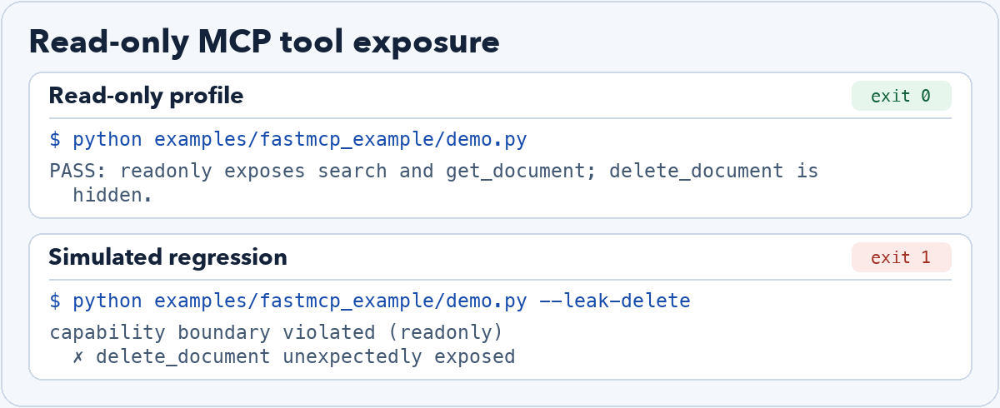

# mcp-capguard

[](https://github.com/denis-samatov/mcp-capguard/actions/workflows/ci.yml)

**Test which MCP tools each configuration profile exposes.** Use pytest or the
CLI to catch missing required tools and unexpected access in CI.

[Run the demo](#see-the-regression-in-one-minute) ·
[Quick start](#quick-start) ·
[Real-server pilots](#pilots-with-real-servers) ·
[API reference](#api-reference)

## See the regression in one minute

The [runnable MCP SDK demo](examples/fastmcp_example/README.md) checks a read-only
profile twice. The second run deliberately exposes `delete_document` under the
same policy.

<picture>
  <source media="(prefers-color-scheme: dark)" srcset="docs/assets/readonly-demo-dark.png">
  
</picture>

From the repository root, install the development dependencies and run both
variants. The demo runs locally without credentials or a running server.

```bash
python -m pip install -e '.[dev]'
python examples/fastmcp_example/demo.py
python examples/fastmcp_example/demo.py --leak-delete
```

The first run exits `0`. The second is expected to exit `1` and report
`delete_document` as unexpectedly exposed. See the [demo walkthrough](docs/demo-walkthrough.md)
for a pinned revision and the full transcript.

## The problem this solves

A read-only MCP profile can accidentally expose a write tool after a configuration
change or a refactor. Declare which tools the profile must expose and which it
must hide. capguard checks that policy on every run.

## How it works

For each profile, capguard passes your settings to the server factory, reads
the tool names from `list_tools()` and checks them against the profile policy.
The core runs in process. A custom `list_tools()` adapter can isolate an upstream
server in a worker, as the Google Workspace example does for its global registry.
Runtime depends on your factory and its tool-listing implementation.

If filtering happens at request time, use a `list_tools()` adapter that retrieves
the client-visible list. The Atlassian pilot demonstrates this with an in-memory
FastMCP Client. Listing an unfiltered internal registry would test the wrong boundary.

Your server only needs to satisfy one contract:

```python
def factory(settings: Any) -> Any: ...  # returns a server with .list_tools()
```

`list_tools()` can be sync or async, and can return either plain strings or
tool objects with a `.name` attribute (like `mcp.types.Tool`). If your
factory returns a wrapper object (e.g. an `Application` whose real server
lives at `.mcp_server`), pass `accessor=lambda app: app.mcp_server` — explicit,
not guessed.

## Scope

capguard checks a declared tool policy against each configuration profile at
test time. It does not compare a server to a previous snapshot or check tool
schemas or behavior. The permission test follows the same pattern as
[`check_tool_matrix.py`](https://github.com/denis-samatov/yandex-workspace-mcp/blob/main/scripts/check_tool_matrix.py)
in `yandex-workspace-mcp`; this library makes that pattern reusable.

By default only declared requirements and prohibitions are checked. An undeclared
tool is allowed; keep the policy current when adding tools. Set `strict=True` on a
`CapabilityProfile` (or pass it to `assert_capability_boundary`) to treat the policy
as a closed allowlist: every exposed tool must then be listed in `must_expose`, and
any other tool fails as "exposed but not declared". Tool exposure checks do not
replace runtime authorization tests.

The example in [Agent Research Commons #125](https://github.com/mbabby/agent-research-commons/issues/125)
checks tool exposure using synthetic lists of tool names. Invocation authorization
requires separate tests that exercise actual tool calls.

**Version boundary:** strict mode is included in the unpublished `0.2.0rc1`
release candidate. The published GitHub v0.1.2 wheel does not contain this API;
use a reviewed source SHA or a locally built candidate wheel for `strict=True`.
The v0.1.2 installation command below remains the previous published version.
See [release acceptance](RELEASING.md) for external typed-consumer and upgrade
checks. No PyPI release is currently advertised.

## Install a released wheel

Install the [v0.1.2 release](https://github.com/denis-samatov/mcp-capguard/releases/tag/v0.1.2)
without cloning the repository:

```bash
python -m pip install 'https://github.com/denis-samatov/mcp-capguard/releases/download/v0.1.2/mcp_capguard-0.1.2-py3-none-any.whl'
capguard --help
```

The wheel includes `py.typed` for consumer type checking. Your existing server
project supplies its own MCP SDK; capguard's runtime package does not require one.

## Install from source

For an existing server project, install directly from GitHub in one command:

```bash
python -m pip install 'mcp-capguard @ git+https://github.com/denis-samatov/mcp-capguard.git'
```

This tracks the default branch. For reproducible CI, pin a reviewed commit SHA
with `@<commit-sha>` after `.git`. A PyPI release is not yet advertised here.

Source and v0.1.2 release assets include the `py.typed` marker so mypy can check
capguard's public annotations in consumer projects. The older v0.1.1 release
assets predate this packaging fix.

Clone the repository and install it in a virtual environment:

```bash
git clone https://github.com/denis-samatov/mcp-capguard.git
cd mcp-capguard
python -m venv .venv
source .venv/bin/activate  # Windows: .venv\Scripts\activate
python -m pip install -e .
```

The optional FastMCP example needs the development dependencies:

```bash
python -m pip install -e '.[dev]'
```

## Quick start

`conftest.py` (or any module — point `capguard_profiles` at it):

```python
from mcp_capguard import CapabilityProfile
from myserver import create_app, Settings


def capguard_profiles() -> list[CapabilityProfile]:
    return [
        CapabilityProfile(
            name="readonly",
            factory=create_app,
            settings=Settings(write_enabled=False),
            must_expose=frozenset({"search", "get_document"}),
            must_not_expose=frozenset({"delete_document", "send_email"}),
        ),
        CapabilityProfile(
            name="editor",
            factory=create_app,
            settings=Settings(write_enabled=True, admin_enabled=False),
            must_expose=frozenset({"search", "get_document", "update_document"}),
            must_not_expose=frozenset({"delete_workspace"}),
        ),
    ]
```

`pytest.ini` (or the `[tool.pytest.ini_options]` table in `pyproject.toml`):

```ini
[pytest]
capguard_profiles = conftest:capguard_profiles
```

Any test file:

```python
def test_capability_boundary(capguard_profile):
    capguard_profile.check_sync()
```

Run `pytest` — one test is generated per profile, and a failure names the
specific profile and the specific tool that broke the policy.

A complete, runnable version of this against the real `mcp` SDK's
`MCPServer` lives in [`examples/fastmcp_example`](examples/fastmcp_example) —
including a server where a destructive tool is conditionally registered, so
you can see capguard catch the exact regression it's built for.

## CLI

For CI systems that don't run pytest directly:

```bash
capguard check --profiles conftest:capguard_profiles
```

## Pilots with real servers

Two reproducible examples exercise actual upstream factories with pinned commits:

- [Yandex Workspace MCP](examples/yandex_workspace_pilot/README.md): MCP SDK 2.3.0,
  readonly, editor without deletion, and disabled services.
- [MCP Atlassian](examples/mcp_atlassian_pilot/README.md): FastMCP 3.4.10 / MCP SDK 1.30.0,
  readonly, readwrite, and a two-tool allowlist, using an in-memory client adapter
  to include request-time tool filtering.

Each pilot runs in its own Python 3.12 environment, checks three profiles, and
proves the same policy rejects an intentionally enabled write capability.
Their pytest runs block TCP sockets and require no real credentials. These are
compatibility examples, not evidence of independent upstream adoption.

Read the [practical write-up on choosing the client-visible boundary](docs/client-visible-tools.md).
For two additional adapters and a three-project reproduction shortlist, see
[external reproduction scenarios](docs/external-reproductions.md): real Gmail/Drive
tools from Google Workspace MCP and Airbyte's filter library with local stub tools.
If you reproduce a pilot or try capguard on your own server,
[share a compatibility report](https://github.com/denis-samatov/mcp-capguard/issues/new?template=compatibility-report.yml)
with your versions, command and outcome. Successful runs and installation failures
are both useful.

## API reference

- **`CapabilityProfile(name, factory, settings, must_expose=frozenset(), must_not_expose=frozenset(), accessor=None, strict=False)`**
  — a declarative profile. `.check()` (async) and `.check_sync()` run it.
- **`get_exposed_tool_names(factory, settings, *, accessor=None) -> set[str]`**
  — the low-level introspection primitive, usable directly without the
  profile/plugin machinery.
- **`assert_capability_boundary(exposed, *, must_expose=(), must_not_expose=(), profile_name=None, strict=False)`**
  — the assertion primitive. Raises `CapabilityViolation` (an
  `AssertionError` subclass) with sets for `.missing`, `.forbidden`,
  `.undeclared` and `.exposed` in the source version.

## What this doesn't do (yet)

- **Black-box mode.** Testing a server you didn't write, over stdio/HTTP,
  the way `mcpward`/`covenant-mcp` do — deliberately out of scope for this
  release. It's a different mechanism (subprocess + protocol handshake per
  profile) and would dilute the one thing this tool does well.
- **Schema-drift detection.** This release checks tool exposure policies only.
- **YAML-driven settings construction.** Real `Settings` classes carry
  secrets and validators that don't round-trip through YAML safely; you
  construct them in Python, same as any other test fixture.

## License

[MIT](LICENSE).
